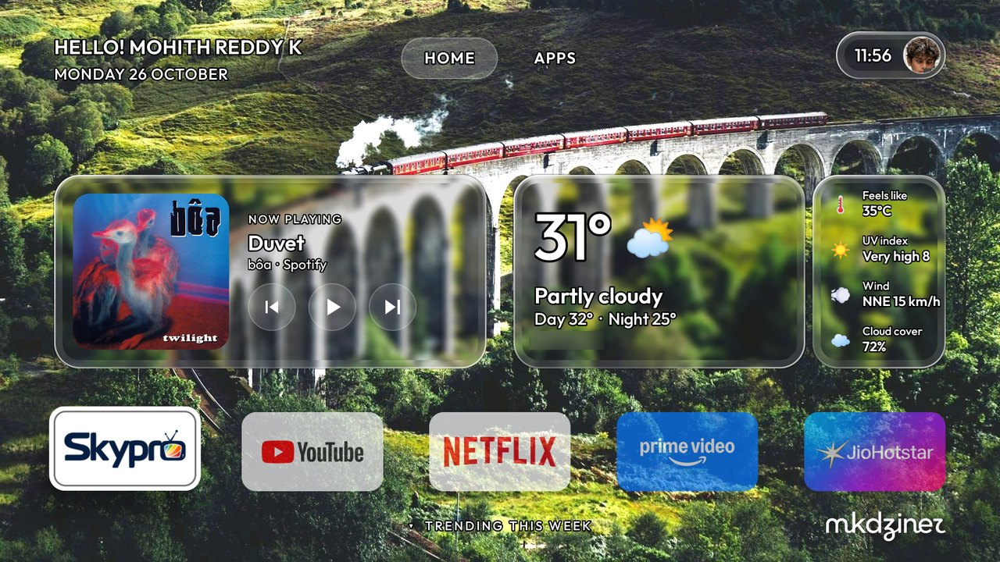
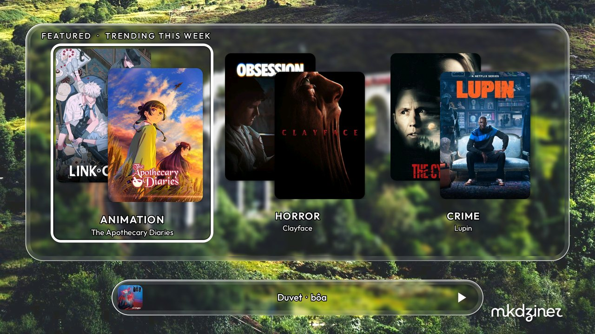
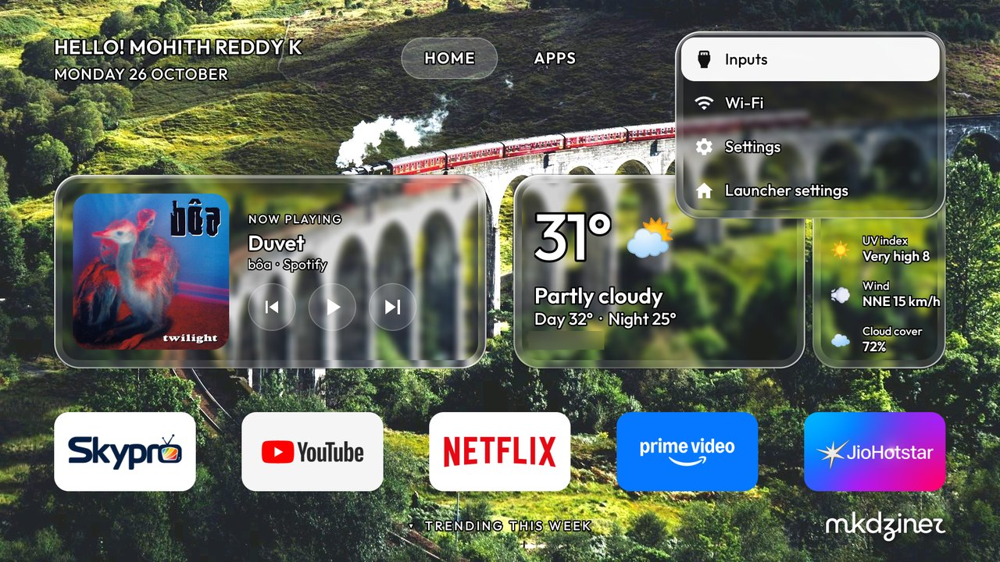
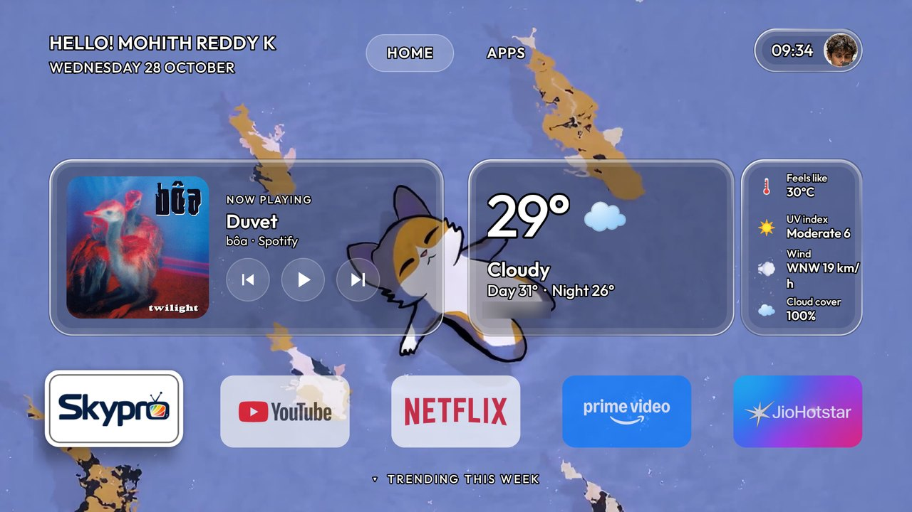

<p align="center">
  
</p>

<p align="center">
  <b>A liquid-glass home screen for Android TV and Google TV.</b><br>
  Ad-free, light on a 2 GB TV, and fully reversible.
</p>

<p align="center">
  
  
  
  <a href="LICENSE"></a>
</p>

---



Lumen replaces the ad-filled Google TV home with a calm dashboard: your greeting, what's playing, the weather and
your favourite apps on clear glass over a wallpaper that fits your mood. Designed by **mkdziner**, built on
[CleanYourTV](https://github.com/Gathin23/cleanyourtv) by Gathin ([@gathint](https://x.com/gathint)).

## Features

| | |
|---|---|
| 🪟 **Liquid glass** | Clear glass cards with edge refraction and a specular rim. Android 9 has no live blur, so it's computed once from the wallpaper. |
| 🏠 **Dashboard home** | Greeting and date, HOME · APPS tabs, a time + photo pill that opens Inputs, Wi-Fi and Settings, and five favourite apps. |
| 🎵 **Now playing** | Whatever is playing (Spotify, YouTube Music…) with album art and controls; the remote's media keys work too. |
| 🌤 **Weather** | Temperature, condition, day / night, feels like, UV, wind and cloud cover from [Open-Meteo](https://open-meteo.com): free, no account. |
| 🎬 **Trending** | Press Down for this week's movies and shows from [TMDB](https://www.themoviedb.org), grouped by genre. |
| 🖼 **Wallpapers by mood** | Five static and five live (video) wallpapers. Live ones stop the moment an app opens, so the app always gets the video decoder. |
| 🌊 **Smooth motion** | One set of curves, spring focus, menus that fade out; designed speed even with system animations at 0.5×. |
| 🪶 **Light** | Plain Java, ~1.7 MB with the built-in wallpapers, no background services, no tracking. |

## Screenshots

| | |
|---|---|
|  |  |
| **Trending:** press Down on Home | **Wallpapers:** pick by mood, Static or Live |
|  |  |
| **Control panel:** from the time pill | **Live wallpaper:** the video plays behind the glass |

## Install

You need a computer on the same Wi-Fi as the TV, Python 3, JDK 17+ and Android SDK platform 34.

**On the TV:** Settings → Device Preferences → About → press **Build** seven times → Developer options → turn on
**USB debugging** (and **Network debugging** if present). Note the TV's IP address.

**On your computer:**

```bash
git clone https://github.com/MinatoXmohith/lumen && cd lumen
python3 -m venv tools/venv && tools/venv/bin/pip install -r tools/requirements.txt
export TV_HOST=192.168.1.50                    # your TV's IP

tools/venv/bin/python -I tools/tv.py --probe  # accept "Allow USB debugging?" on the TV
launcher/build-and-install.sh                 # build Lumen and make it Home
tools/theme.sh path/to/your-theme             # name, photo, city, wallpaper, TMDB key
tools/wallpapers.sh path/to/wallpapers        # optional: your own mood wallpapers
```

Then turn **USB debugging** off again and restart the TV; Lumen keeps working.

**Remove the ads too:** `tools/disable.sh <list>` switches off telemetry and promo apps (never uninstalls), and
`tools/restore.sh <list>` undoes it. Lists for 90+ TV models are in
[CleanYourTV's `examples/`](https://github.com/Gathin23/cleanyourtv/tree/main/examples).

## Theme

A theme is a folder pushed with `tools/theme.sh`:

| File / key | Purpose |
|---|---|
| `config.json` → `greeting_name` | Name in the greeting and the avatar initials |
| `config.json` → `weather_city` | City for the weather card |
| `config.json` → `dock_apps` / `hidden_apps` | Order of your favourite apps, and apps to hide |
| `config.json` → `music_app` | App opened by ▶ when nothing is playing (optional) |
| `wallpaper.jpg` | 1920×1080 default wallpaper |
| `avatar.jpg` | Square photo for the time pill |
| `tmdb_key.txt` | Your free [TMDB API key](https://www.themoviedb.org/settings/api) for Trending. Never commit it. |

**Mood wallpapers:** a folder with `wallpapers.json` (file, thumbnail, mood and name for each), five 1920×1080 images
and five 1080p H.264 videos, pushed with `tools/wallpapers.sh`. Without it, Lumen shows its built-in set.

## Privacy

Lumen goes online only for weather (Open-Meteo, your city's coordinates) and Trending (TMDB, with your key).
No accounts, analytics or ads. Music info is read on the TV through Android's media sessions and never leaves it.

## Credits

- **Design and development:** Mohith Reddy K · [mkdziner](https://github.com/MinatoXmohith).
- **Based on [CleanYourTV](https://github.com/Gathin23/cleanyourtv)** by Gathin ([@gathint](https://x.com/gathint)), MIT: the ADB tools, the restore system and the original launcher. See [NOTICE.md](NOTICE.md).
- [Outfit](https://fonts.google.com/specimen/Outfit) typeface (OFL), [Open-Meteo](https://open-meteo.com) (CC BY 4.0), [TMDB](https://www.themoviedb.org). *This product uses the TMDB API but is not endorsed or certified by TMDB.*

## Licence

[MIT](LICENSE), © 2026 Mohith Reddy K (mkdziner) and Gathin. The Lumen name, icon and banner are not covered.
